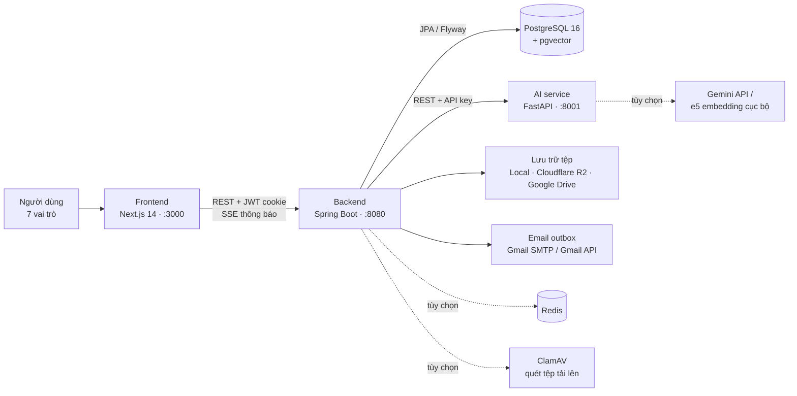
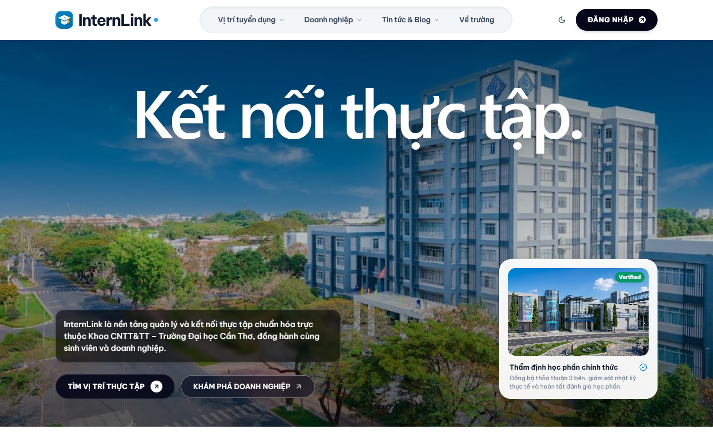
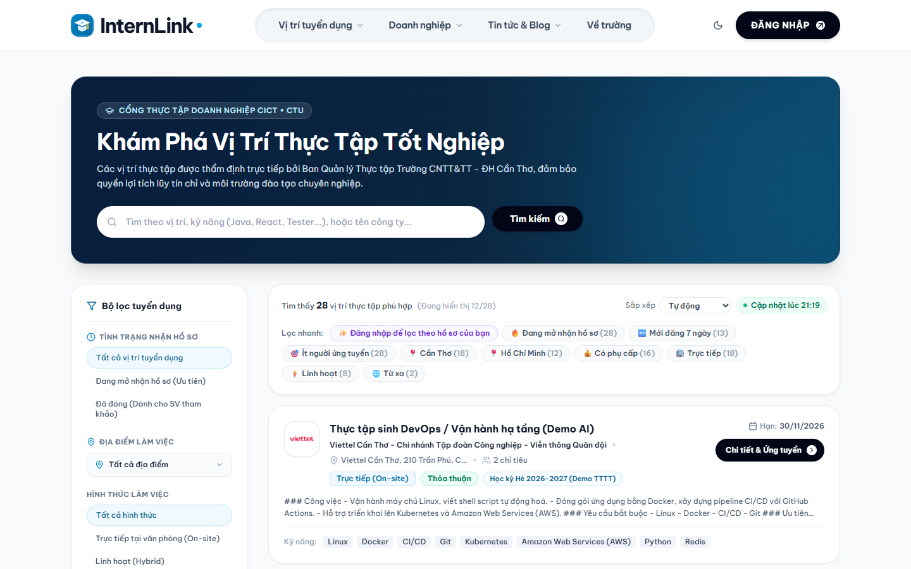
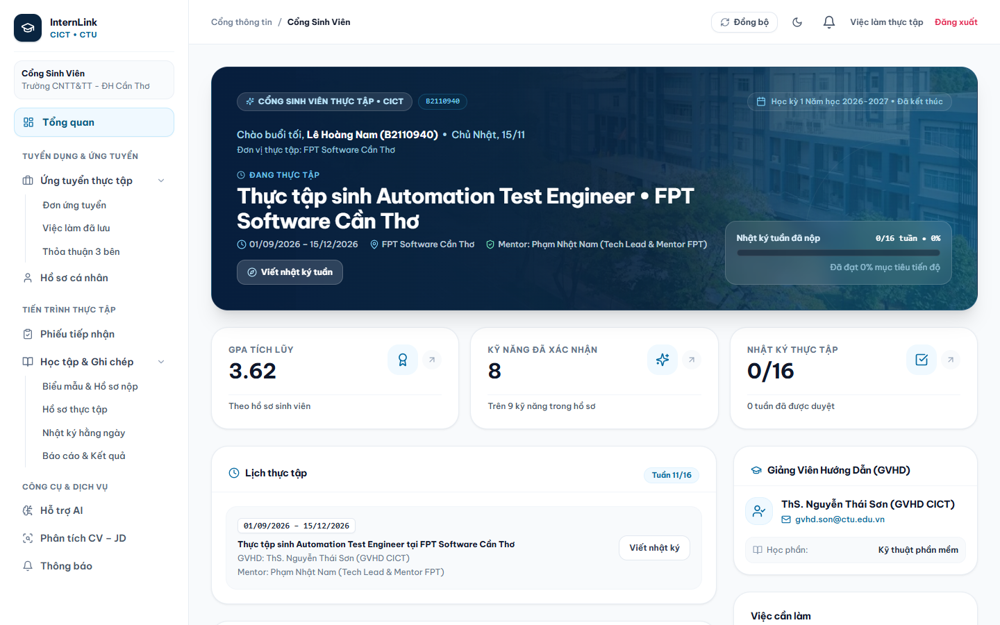
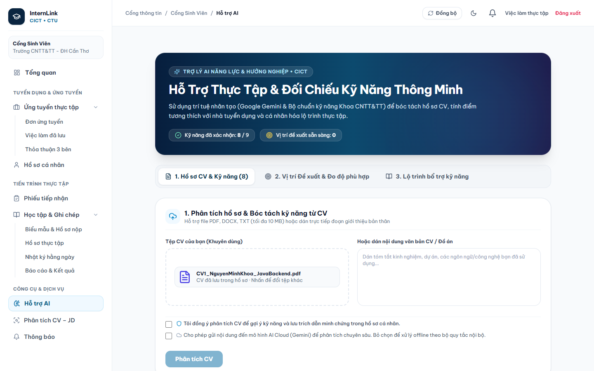
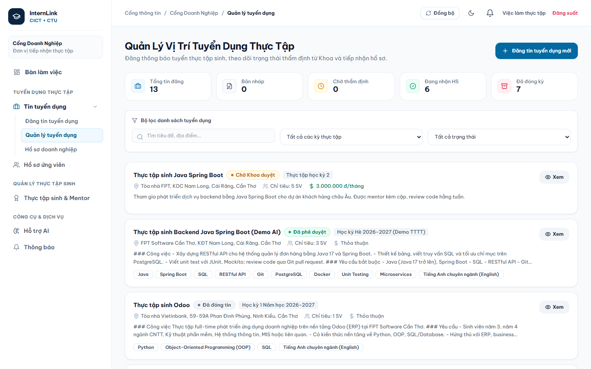
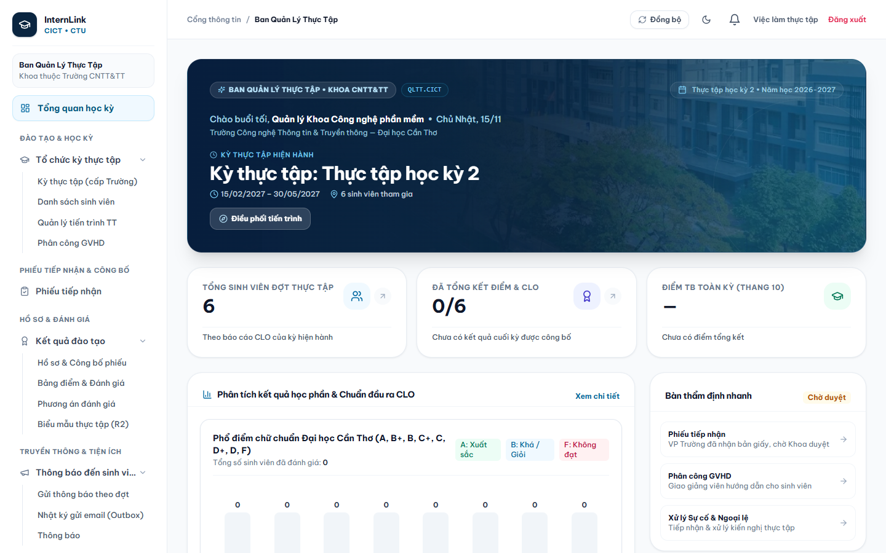
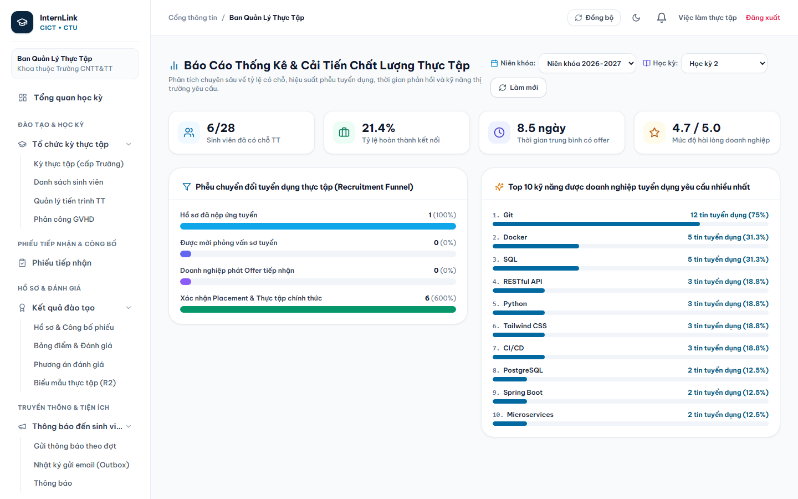
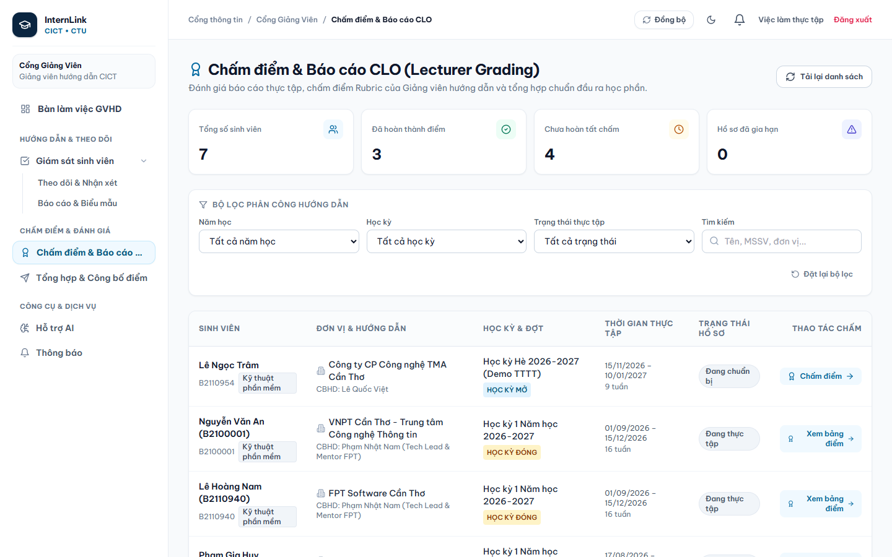
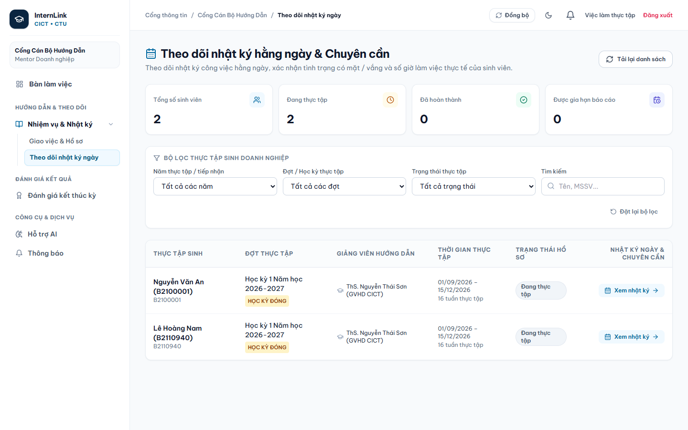

# 🎓 InternLink — Cổng quản lý thực tập tốt nghiệp

[](https://github.com/hao05dev/Internlink-v1-backend/actions/workflows/ci.yml)


InternLink quản lý trọn quy trình thực tập tốt nghiệp giữa **sinh viên**, **doanh nghiệp** và **Trường CNTT&TT – Đại học Cần Thơ (CICT)**. Quy trình gồm: tuyển dụng và ứng tuyển, phiếu tiếp nhận, thỏa thuận ba bên, nhật ký tuần, đánh giá của mentor và giảng viên, chấm điểm theo rubric/CLO, và báo cáo thống kê cho khoa.

Hệ thống gồm 3 repo:

| Repo | Vai trò | Công nghệ |
|---|---|---|
| **Internlink-v1-backend** (repo này) | API nghiệp vụ, phân quyền, lưu trữ, email, thông báo | Spring Boot 3.3, Java 21, JPA, Flyway, PostgreSQL 16 + pgvector |
| Internlink-v1-frontend (private) | Cổng web cho 7 vai trò | Next.js 14 App Router, TypeScript, Tailwind CSS, Zustand |
| Internlink-v1-ai (private) | Trích xuất kỹ năng, gợi ý việc làm, phân tích CV–JD | FastAPI, taxonomy kỹ năng IT (ESCO), Gemini / e5 (tùy chọn) |

---

## Kiến trúc



- **Backend** chia theo module nghiệp vụ trong `src/main/java/com/internlink/core/application`: `auth`, `student`, `company`, `recruitment`, `placement`, `portfolio`, `evaluation`, `exception_case`, `organization`, `analytics`, `ai_matching`, `system`.
- **Cơ sở dữ liệu** được quản lý bằng Flyway (`src/main/resources/db/migration`), kèm dữ liệu demo. Embedding kỹ năng và tin tuyển dụng được lưu cache theo phiên bản model.
- **AI service** không truy cập DB. Backend gửi hồ sơ và tin tuyển, AI trả về kỹ năng chuẩn hóa, điểm phù hợp và lời giải thích. Khi AI không chạy, backend vẫn hoạt động; các chức năng AI báo lỗi rõ ràng thay vì làm hỏng luồng chính.
- **Email** đi qua outbox, có các chế độ `DISABLED` / `REDIRECT` / `ALLOWLIST` / `LIVE` để không gửi nhầm cho người thật khi chạy thử.

---

## Ảnh màn hình

| Trang chủ | Danh sách việc làm |
|---|---|
|  |  |
| **Sinh viên — tổng quan** | **Sinh viên — hỗ trợ AI** |
|  |  |
| **Doanh nghiệp — quản lý tin tuyển** | **Khoa — tổng quan học kỳ** |
|  |  |
| **Khoa — thống kê** | **Giảng viên — chấm điểm & CLO** |
|  |  |
| **Mentor — theo dõi nhật ký** | |
|  | |

Ảnh chụp từ dữ liệu seed demo bằng `node scripts/capture-screenshots.mjs assets/screenshots`. Script cần cả 3 service đang chạy.

---

## Tính năng theo vai trò

| Vai trò | Chức năng chính |
|---|---|
| **Sinh viên** | Hồ sơ và CV, tìm và lưu việc làm, ứng tuyển, phiếu tiếp nhận (tự tìm nơi thực tập), thỏa thuận 3 bên, nhật ký ngày/tuần, nộp báo cáo cuối kỳ, gợi ý việc làm và phân tích CV–JD bằng AI |
| **Doanh nghiệp (HR)** | Hồ sơ công ty, đăng tin (khoa duyệt), quản lý ứng viên theo Kanban, mời phỏng vấn, gửi offer, phân công mentor |
| **Mentor** | Theo dõi và nhận xét nhật ký, đánh giá hằng tuần, đánh giá cuối kỳ |
| **Giảng viên hướng dẫn** | Giám sát sinh viên, duyệt nhật ký, chấm theo rubric và chuẩn đầu ra CLO |
| **Ban quản lý thực tập (Khoa)** | Kỳ thực tập, danh sách sinh viên (import Google Sheets), phân công GVHD, duyệt tin và phiếu tiếp nhận, xử lý ngoại lệ, công bố kết quả, thống kê |
| **Văn phòng Trường** | Tiếp nhận phiếu, giấy giới thiệu, duyệt tin tuyển, bài viết hướng nghiệp |
| **Quản trị hệ thống** | Người dùng, đơn vị, doanh nghiệp, dung lượng lưu trữ, nhật ký kiểm toán |

---

## Tài khoản demo

Tất cả tài khoản seed dùng mật khẩu chung: **`Password@123`** — đăng nhập tại `http://localhost:3000/login`.

| Vai trò | Email | Dashboard |
|---|---|---|
| ADMIN | `admin.cict@ctu.edu.vn` | `/admin/dashboard` |
| FACULTY_ADMIN | `qltt.cict@ctu.edu.vn` | `/faculty/dashboard` |
| SCHOOL_OFFICE | `vanphong.cict@ctu.edu.vn` | `/school-office/dashboard` |
| LECTURER | `gvhd.son@ctu.edu.vn` | `/lecturer/dashboard` |
| STUDENT | `b2110940@student.ctu.edu.vn` | `/student/dashboard` |
| COMPANY_REP | `tuyendung.fptct@fpt.com` (tab "Doanh nghiệp") | `/company/dashboard` |
| COMPANY_MENTOR | `mentor.nam@fpt.com` (tab "Doanh nghiệp") | `/mentor/dashboard` |

### Bộ dữ liệu demo đầy đủ (đợt "HK1 2026–2027 (Demo)")

Nạp bằng `psql -d internlink_db -f ../scripts/seed_demo_full.sql` (chạy lại an toàn), xoá bằng `../scripts/reset_demo.sql`. Sinh lại từ `scripts/demo_data/build_demo.py`. Cùng mật khẩu chung ở trên. Gồm 60 SV, 8 GV, 12 doanh nghiệp, 48 tin tuyển, 78 đơn ứng tuyển, 34 đợt thực tập (đang thực tập / hoàn thành / chấm dứt), nhật ký tuần–ngày, phiếu đánh giá, 14 bài cẩm nang có ảnh bìa, thông báo, cuộc họp.

| Vai trò | Email | Tình huống |
|---|---|---|
| STUDENT | `b2398034@demo.internlink.vn` | Đang thực tập tại MediMekong, đã có 8 nhật ký tuần |
| STUDENT | `b2398055@demo.internlink.vn` | Đã hoàn thành, có kết quả cuối |
| STUDENT | `b2398007@demo.internlink.vn` | Đang ứng tuyển, chưa có nơi thực tập |
| LECTURER | `gv.hoangphuc@demo.internlink.vn` | GVHD của `b2398034` |
| LECTURER | `gv.baotran@demo.internlink.vn` | GVHD của `b2398055` |
| COMPANY_REP | `tuyendung.medimekong@demo.internlink.vn` | Doanh nghiệp MediMekong |
| COMPANY_MENTOR | `mentor.mai19.medimekong@demo.internlink.vn` | Mentor của `b2398034` |
| FACULTY_ADMIN | `khoa@demo.internlink.vn` | Ban quản lý Khoa |
| SCHOOL_OFFICE | `vanphongtruong@demo.internlink.vn` | Văn phòng Trường |

Danh sách đầy đủ (đuôi `@demo.internlink.vn`, cùng mật khẩu chung):

- **Giảng viên (8)**: `gv.thanhtam`, `gv.hoangphuc`, `gv.minhthu`, `gv.quockhanh`, `gv.ngocdiem`, `gv.ducthinh`, `gv.baotran`, `gv.huuloc` — mỗi GV có 7–8 SV trong danh sách, 4–5 SV đã có nơi thực tập.
- **Doanh nghiệp (12)**: `tuyendung.<slug>` với slug là `songhau`, `mekongdata`, `ninhkieudigital`, `phusapay`, `cuulongsecure`, `taydocloud`, `chonoi`, `luavangedu`, `dongbangxanh`, `hoasengames`, `medimekong`, `cairanglogistics`.
- **Mentor**: `mentor.<tên><số>.<slug>`, ví dụ `mentor.phat01.songhau`, `mentor.mai19.medimekong`, `mentor.tri20.cairanglogistics` (mỗi DN 1–2 mentor).
- **Sinh viên (60)**: `b23980NN` (MSSV B2398001–B2398060), theo trạng thái:

| MSSV | Trạng thái |
|---|---|
| 001–006 | Chưa ứng tuyển |
| 007–014 | Đang ứng tuyển |
| 015–020 | Đang phỏng vấn |
| 021–024 | Có offer chờ phản hồi |
| 025 | Thỏa thuận 3 bên chờ ký |
| 026–027 | Phiếu tiếp nhận (tự tìm) chờ duyệt |
| 028–029 | Chuẩn bị thực tập (bắt đầu 23/11/2026) |
| 030–033 | Tự tìm nơi thực tập, đã được duyệt |
| 034–054 | Đang thực tập tại DN đối tác (040: sự cố vắng mặt, 045: chuyển đơn vị, 052: chấm dứt sớm) |
| 055–060 | Đã kết thúc (059: chờ GV chấm, 060: không đạt) |

Ngày "hôm nay" của kịch bản là 18/11/2026. Ảnh và PDF demo nằm trên R2 dưới `media/demo/` và `private/documents/demo/`; sinh lại và tải lên bằng `python scripts/demo_data/build_demo.py --upload` (đọc khóa R2 từ `.env`). `reset_demo.sql` không xoá file trên R2.

Lưu ý: seed chuyển kỳ gốc `HK2-2026-2027` (bắt đầu 15/02/2027) từ ACTIVE sang REGISTRATION_OPEN, để kỳ demo là kỳ ACTIVE duy nhất và được dashboard Khoa/VP Trường chọn mặc định. `reset_demo.sql` trả kỳ gốc về ACTIVE.

Các tài khoản này chỉ dành cho môi trường phát triển. Khi triển khai thật, hãy đổi mật khẩu hoặc bỏ migration seed.

---

## Chạy trên máy

Yêu cầu: JDK 21, Maven 3.9+, Node.js 20+, Python 3.10+, Docker (cho PostgreSQL). Đặt 3 repo cạnh nhau trong cùng một thư mục cha.

**1. PostgreSQL (+ pgvector) và Redis**

```bash
cp .env.example .env        # điền DB_PASSWORD, JWT_SECRET, ...
docker compose up -d postgres redis
```

**2. Backend — `:8080`**

```bash
mvn spring-boot:run
```

Flyway tự tạo schema và nạp dữ liệu demo. Swagger UI: `http://localhost:8080/swagger-ui.html`.

**3. AI service — `:8001`**

```bash
cd ../Internlink-v1-ai
cp .env.example .env        # mặc định dùng provider cục bộ, không cần API key
pip install -r requirements.txt
uvicorn app.main:app --port 8001
```

Hoặc chạy bằng Docker từ repo backend: `docker compose up -d ai-service`. Tài liệu API: `http://localhost:8001/docs`.

**4. Frontend — `:3000`**

```bash
cd ../Internlink-v1-frontend
cp .env.example .env.local  # BACKEND_API_ORIGIN=http://localhost:8080
npm install
npm run dev
```

---

## Kiểm thử và CI

Mỗi repo có GitHub Actions chạy trên mọi push và pull request vào `main`.

| Repo | Lệnh | Nội dung |
|---|---|---|
| Backend | `mvn verify` | ~450 test JUnit/Mockito; test tích hợp chạy trên H2 và PostgreSQL 16 + pgvector (service container trong CI) |
| Frontend | `npm run lint`, `npx tsc --noEmit`, `npm test` | ESLint, kiểm tra kiểu TypeScript, ~100 file test Vitest |
| AI | `python -m pytest` | ~110 test pytest trên Python 3.10 và 3.13, gồm test cho benchmark |

---

## Đánh giá thuật toán gợi ý việc làm

AI service xếp hạng tin tuyển cho sinh viên bằng **Skill + Vector Hybrid**: điểm kỹ năng (0.8 × kỹ năng bắt buộc + 0.2 × kỹ năng tùy chọn, sau chuẩn hóa qua taxonomy và từ đồng nghĩa) kết hợp với độ tương đồng vector.

Benchmark tổng hợp gồm 150 sinh viên × 30 tin mỗi người. Hồ sơ bị nhiễu: khai thiếu ~35% kỹ năng, mô tả dùng từ đồng nghĩa hoặc câu diễn giải, và 20% tin là tin mồi. Nhãn suy ra từ tập kỹ năng ẩn, không gán tay.

| Phương pháp | nDCG@10 | KTC 95% |
|---|:-:|:-:|
| BM25 | 0.335 | [0.305, 0.369] |
| Jaccard | 0.350 | [0.319, 0.384] |
| Vector cosine (hashing) | 0.435 | [0.401, 0.468] |
| Skill-Only | **0.863** | [0.835, 0.889] |
| Weighted Features | 0.861 | [0.833, 0.887] |
| Skill + Vector Hybrid | 0.858 | [0.830, 0.884] |

Kết luận:
- Chuẩn hóa và khớp theo kỹ năng là yếu tố quyết định: nDCG@10 cao hơn ~0.42–0.52 so với các phương pháp chỉ dựa trên văn bản (p < 0.001), và ổn định qua 5 seed.
- Với vector hashing hiện tại, Hybrid **chưa tốt hơn** Skill-Only (chênh −0.006, p = 0.18, không có ý nghĩa thống kê). Bước tiếp theo là chạy lại benchmark với embedding ngữ nghĩa thật (e5 / Gemini).

Chi tiết cách sinh dữ liệu, kiểm định thống kê và giới hạn nằm trong repo AI: `evaluation-reports/hard_benchmark_summary.md`.

---

## Bản quyền

Đề tài luận văn tốt nghiệp — Trường Công nghệ Thông tin & Truyền thông, Đại học Cần Thơ (CICT – CTU).
